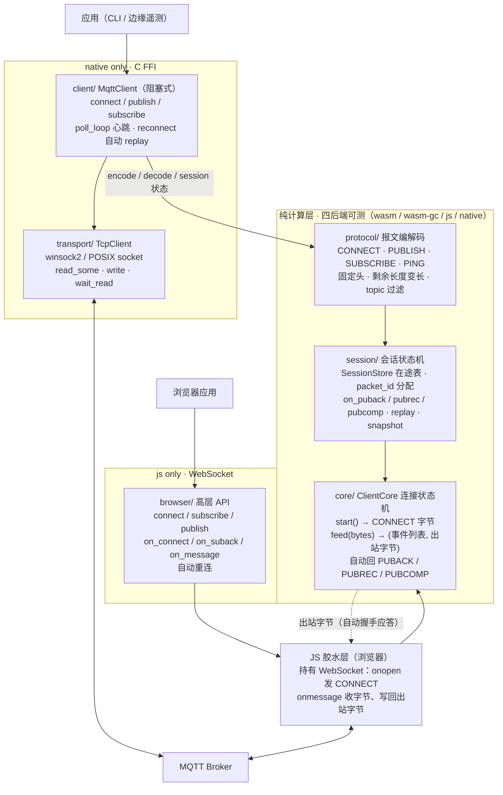
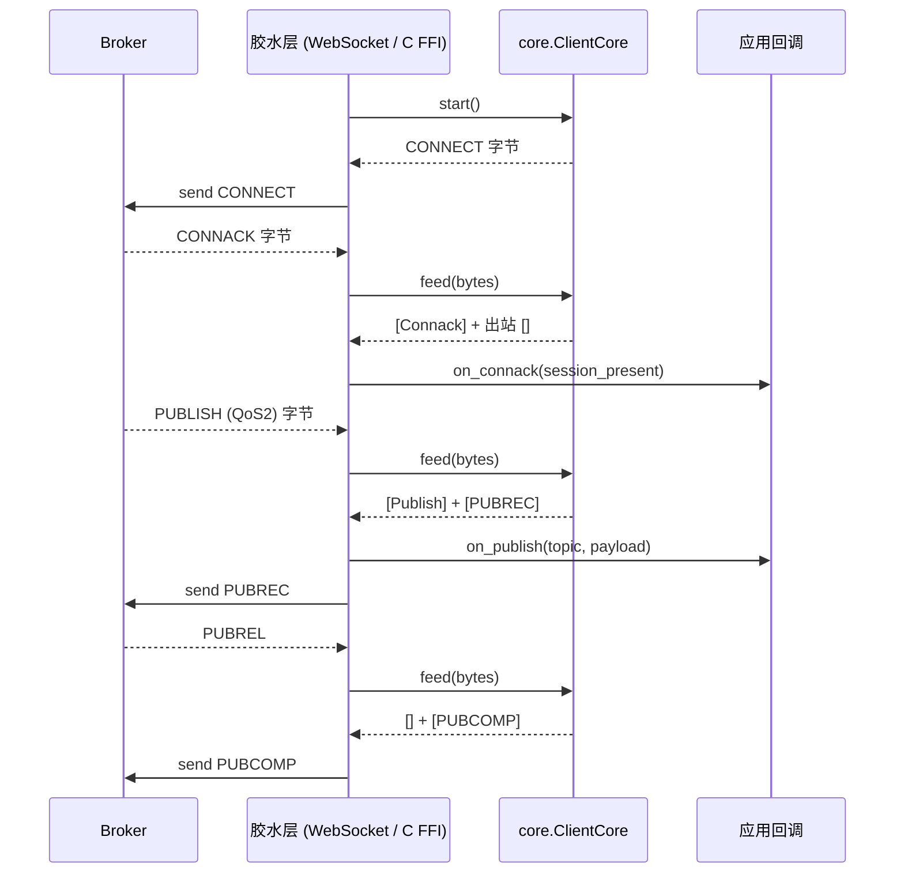

# moon-mqtt

MoonBit 写的 MQTT 3.1.1 客户端。浏览器里走 WebSocket，native 上走 C FFI TCP，两条路径共用同一份纯计算状态机。QoS0/1/2 全支持，QoS2 exactly-once 和持久会话恢复是重点。MQTT 5.0 在路线图上。

| 宿主 | 包 | 形态 |
|---|---|---|
| 浏览器（js 后端） | `browser/` | 回调式，publish 支持 QoS0/1/2，断线 1 秒自动重连 |
| native | `client/` | 阻塞式，自动心跳，重连后自动 replay |
| 纯计算层 | `protocol/` `session/` `core/` | wasm / wasm-gc / js / native 四后端可测 |

## 安装

需要 [MoonBit 工具链](https://www.moonbitlang.com/)（moon ≥ 0.1.20261012）。浏览器项目用 js 后端，native 用默认后端。

```bash
moon add Duckweed/moon-mqtt@0.2.1
```

也可以直接写进 `moon.mod`：

```toml
import {
  "Duckweed/moon-mqtt",
}
```

## 在线 demo

开启 GitHub Pages 后，demo 地址是 https://duckweed-yhb.github.io/moon-mqtt/demo/ ，页面源文件在 `docs/demo/`。

页面连公共 EMQX `broker.emqx.io:8084`，订阅 `sensors/#` QoS1，收到 SUBACK 后发一条 QoS1 再收回自己的消息。点「强制断开（测试重连）」能走一次重连。

本地起服务：

```powershell
pwsh scripts/build-demo.ps1   # moon build --target js examples/browser-demo，产物复制到 docs/demo/
python -m http.server 8765    # 在仓库根目录
# 浏览器打开 http://127.0.0.1:8765/docs/demo/
```

页面加载同目录的 `browser-demo.js`，不依赖 `_build` 路径，所以直接静态托管也能跑。

## 浏览器用法

`browser/` 是 js 后端的高层封装，内部持有 `core/ClientCore`。WebSocket 对象由 JS 胶水层拿着，MoonBit 侧只做纯计算：`onopen` 发 CONNECT，`onmessage` 把字节喂给 `core.feed()`，回包再写回 broker。

```moonbit
// your-app/main.mbt
import {
  "Duckweed/moon-mqtt/browser" @browser,
  "Duckweed/moon-mqtt/protocol" @protocol,
}

fn main() -> Unit {
  let client = @browser.connect_persistent("broker.emqx.io", 8084, "my-browser-client")

  @browser.on_connect(client, fn() {
    println("connected")
    @browser.subscribe(client, "sensors/#", @protocol.qos1())
  })

  // SUBACK 之后再发，broker 已经建好订阅，能收到自己发的消息
  @browser.on_suback(client, fn() {
    @browser.publish(client, "sensors/hello", [0x68, 0x69], @protocol.qos1())
  })

  @browser.on_message(client, fn(topic, payload) {
    println("recv " + topic + " " + payload.length().to_string() + " bytes")
  })
}
```

API：

| 函数 | 说明 |
|---|---|
| `connect(host, port, client_id)` | WSS 连上去，发 CONNECT，clean_session=true |
| `connect_opts(host, port, opts)` | 自定义 CONNECT：认证、遗嘱、clean_session |
| `connect_persistent(host, port, client_id)` | clean_session=false，重连后拿回同一个会话 |
| `on_connect(client, handler)` | 收到 CONNACK 后回调 |
| `on_suback(client, handler)` | 收到 SUBACK 后回调，适合在这里开始 publish |
| `on_message(client, handler)` | 收到 PUBLISH 时回调 `(topic, payload)` |
| `subscribe(client, topic, qos)` | 订阅主题 |
| `publish(client, topic, payload, qos)` | 发布消息，QoS0/1/2 |
| `disconnect(client)` | 发 DISCONNECT 并关闭连接 |

无头 Chrome 实测（2026-10-22，连公共 EMQX）：

```
[browser] session_present=0
[demo] connected, subscribing sensors/# QoS1
[browser] suback
[demo] suback, publishing QoS1 sensors/hello
[demo] recv topic=sensors/hello payload=2 bytes
```

点页面上的「强制断开（测试重连）」之后：

```
[browser] reconnect attempt #1 in 1s
[browser] session_present=1, replay 0 frame(s)
[demo] connected, subscribing sensors/# QoS1
```

`session_present=1` 说明 broker 按 clean_session=false 把会话留着；`replay 0 frame(s)` 说明那次没有在途的 QoS1/2 帧要重发，订阅由 `on_connect` 重新发起。

## 竞品对照

MoonBit 生态里已有两个相关项目：

| 项目 | 做了什么 | 缺什么 |
|---|---|---|
| `zbhzs1/moonbit-mqtt` | 报文 codec | 无 transport、无 client runtime |
| `Strangelight-Merser/moon-mqtt-client@0.7.1` | native async client，TCP/TLS/WS/WSS，QoS0/1 | 无 QoS2；README 明确不提供浏览器适配 |
| **moon-mqtt** | QoS0/1/2 全量、持久会话恢复、`core/` 纯计算状态机、`browser/` 浏览器高层 API | 阻塞式，无异步封装 |

浏览器这一侧，两个项目都不覆盖。

参考移植（原创重写，不复制源码）：API 形状参考 [MQTT.js](https://github.com/mqttjs/MQTT.js)（MIT），协议行为参考 [Eclipse Paho C](https://github.com/eclipse/paho.mqtt.c)（EPL-2.0/EDL-1.0）。本项目许可证 **MIT**。

## 运行示例

| 示例 | 跑法 | 做什么 |
|---|---|---|
| `examples/pubsub` | `moon run examples/pubsub` | 报文编解码往返，不连 broker |
| `examples/resume` | `moon run examples/resume` | QoS2 中断重连时间线，纯计算 |
| `examples/browser-demo` | `pwsh scripts/build-demo.ps1` | 浏览器端到端，页面在 `docs/demo/` |
| `examples/ws-spike` | `moon build --target js examples/ws-spike` | 裸 WebSocket spike，留作协议层对照 |

### pubsub：报文编解码

```moonbit
let qos = match @protocol.qos_from_int(1) { Some(q) => q None => return }
let pkt = @protocol.PublishPacket::new(
  "sensors/temp", [0x32, 0x33], qos, false, false, 7,
)
let bytes = @protocol.encode_publish(pkt)
match @protocol.decode_publish(bytes) { ... }
```

输出：`encoded (20 bytes)` / `decoded: topic=sensors/temp payload=[50, 51] qos=1`

### resume：QoS2 中断重连

不连 broker，纯计算走一遍：发 QoS2 PUBLISH → 收 PUBREC → 断线 → 重连 replay → 发 PUBREL → 收 PUBCOMP → 清空。MQTT 3.1.1 持久会话语义的核心演示。

### browser-demo：浏览器端到端

见上文「在线 demo」。`examples/ws-spike/` 是更早的一次裸 WebSocket spike：胶水层直接手写 JS，收到 CONNACK 就订阅 `sensors/#` 并发一条 QoS2，用来对照协议层。

## Native TCP

`client/` 是阻塞式的 `MqttClient`，适合 CLI 和边缘遥测上报这类确定性场景。

```moonbit
// 自定义 CONNECT（带认证 + 遗嘱 + 持久会话）
let opts = @protocol.ConnectPacket::new("demo-client")
  .with_keep_alive(30)
  .with_clean_session(false)
  .with_auth("user", [0x70, 0x61, 0x73, 0x73])   // "pass"
  .with_will("status", "offline".to_bytes(), @protocol.qos1(), false)

let client = @client.connect_opts("broker.hivemq.com", 1883, opts)?

client.subscribe_with_handler("sensors/#", @protocol.qos1(), fn(topic, payload) {
  println("recv " + topic)
})?

// 每 1 秒 poll 一次，累计到 keep_alive 自动发 PINGREQ
match client.poll_loop(600, 1000) {
  Ok(_) => ()
  Err(_) => {
    let client = client.reconnect()?
    println("reconnected, session_present=" + client.is_session_present().to_string())
  }
}
client.disconnect()?
```

`?` 是 Result 传播。`qos0()` / `qos1()` / `qos2()` 用来跨包构造 QoS 枚举。

典型用法：连上后周期 publish 传感器读数（QoS1），订阅控制指令（QoS0），到点 ping，结束 disconnect。

## 命令行验证

js 产物也能在 Node 里跑，CI 和本地排查时不用每次开浏览器。`examples/ws-spike/` 编译成 js bundle 后连公共 EMQX，把每帧 hex 打出来：

```powershell
moon build --target js examples/ws-spike
node "_build\js\debug\build\examples\ws-spike\ws-spike.js"
```

输出里有 CONNECT 22 字节、CONNACK `20 02 00 00`、SUBACK，以及 `sensors/test` 上收到的 `68 65 6C 6C 6F`（ASCII "hello"）。spike 还会在 CONNACK 之后发一条 QoS2 PUBLISH，PUBREC 回来时 core 自动回 PUBREL，收到 PUBCOMP 清掉在途。这一段是命令行链路自检；浏览器证据看上面无头 Chrome 的日志。

## 设计

五层结构，框里标了纯计算层和仅 native / 仅 js 的部分：



两条路径的关系：

- **浏览器**：`browser/` 持有 `core/ClientCore`，JS 胶水层持有 `WebSocket`，经 mangled 名回调 MoonBit 的 `browser_on_message` / `browser_on_close`。`core/` 吐事件给应用，同时吐出站字节由 `browser_send` 写回 broker。
- **native**：`client/` 用 `protocol/` + `session/` + `transport/` 组装阻塞式 `MqttClient`，走 C FFI TCP。
- `protocol/`、`session/`、`core/` 不 import 任何 platform 依赖；`transport/` 和 `client/` 只编 native，`browser/` 只编 js。
- QoS2 exactly-once（PUBREC/PUBREL/PUBCOMP 三段握手）和断线重连的状态边界是核心。

`feed()` 一次调用同时产出事件和出站字节，所以胶水层不需要自己判断该回哪个包：



详细设计见 [docs/ARCHITECTURE.md](docs/ARCHITECTURE.md)。

### CONNECT 字段支持

| MQTT 3.1.1 CONNECT 字段 | 支持 |
|---|---|
| Client Identifier | ✅ 必填 |
| Keep Alive | ✅ 默认 60s，可配 |
| Clean Session | ✅ 默认 true，可配 |
| Username / Password | ✅ 可选 |
| Will Message（topic / payload / QoS / retain） | ✅ 可选 |
| 持久会话恢复 | ✅ 在途 QoS1/2 PUBLISH 由 `SessionStore` 记录，重连后 `replay()` 按 §4.4 重发 |

## 状态

- [x] `protocol/` MQTT 3.1.1 报文编解码
- [x] `session/` 会话状态机（QoS2 exactly-once、packet_id 分配、在途持久化）
- [x] `core/` ClientCore（start/feed、入站 QoS1/2 自动握手、出站 QoS1/2 在途追踪、reconnect、replay）
- [x] `transport/` native TCP（C FFI，跨平台，read 带超时）
- [x] `client/` 阻塞式高层 API（poll_loop 自动心跳、reconnect 自动 replay）
- [x] `browser/` 浏览器高层 API（connect / connect_persistent / on_connect / on_suback / on_message / subscribe / publish / disconnect）
- [x] 浏览器端到端实测：2026-10-22 无头 Chrome，首连、publish QoS1、收消息、强制断开后重连到 `session_present=1`
- [x] `moon test --target wasm-gc` 77/77；`moon test --target native` 80/80
- [x] `moon check --target js --deny-warn` 通过，0 警告
- [ ] 发布到 mooncakes（0.2.1）

## 构建与测试

```bash
moon check
moon check --target js --deny-warn   # 0 警告
moon test --target wasm-gc           # 77/77
moon test --target native            # 80/80
moon run examples/pubsub
moon run examples/resume
pwsh scripts/build-demo.ps1          # 浏览器 demo
```

CI（GitHub Actions，Linux / Windows 双矩阵）跑 check + build + 四后端 test + 示例运行。

## 手动验证（native 连真 broker）

```bash
# 1. 起本地 broker
mosquitto -p 1883 -v

# 2. 另开终端订阅
mosquitto_sub -h 127.0.0.1 -t 'sensors/#' -v

# 3. 跑 MoonBit 程序（connect → publish → subscribe → ping → disconnect）
#    代码见上文「Native TCP」
```

## AI 工具使用说明

开发中用了 AI 编程工具，目标、技术路径、质量边界和开源合规由参赛者本人把控：

- AI 辅助了报文编解码的样板代码、单测用例生成、README 初稿润色。
- 人把控了选题、五层分层、QoS 状态机边界条件、C FFI 边界设计、已知限制的如实声明、与 mooncakes 现有项目的查重。
- AI 生成的单测都由人对照 OASIS MQTT 3.1.1 规范核过断言；编解码有往返测试（encode → decode → 字段比对）；CI 四后端全绿才合并。
- 不照搬其他开源项目代码（API 参考 MQTT.js / Paho C，实现是 MoonBit 重写）；不把 AI 生成的测试数据当真理。

## 已知限制

- **会话快照落盘**：`SessionStore` 提供 `snapshot()` / `restore()` 字节级原语，写盘由调用方自己做，库不碰文件。
- **`transport/` 和 `client/` 仅 native**：依赖 C FFI socket。`protocol/`、`session/`、`core/` 四后端可测；浏览器走 `browser/` + WebSocket 胶水层，已端到端验证。`browser/` 仅 js 后端。
- **阻塞式 API**：`client/` 是阻塞的，适合 CLI / 边缘遥测；高并发长连接要异步封装，当前没做。
- **同步握手期间收到 PUBLISH**：`publish` 等 PUBACK/PUBREC/PUBCOMP、`subscribe` 等 SUBACK 时，如果 broker 推来订阅主题的 PUBLISH，当前代码报 `"expected XXX"` 并丢掉这帧。边发边收请用 `poll_loop` + `subscribe_with_handler`。
- **坏协议帧卡住缓冲**：`core/Framer` 遇到认不出的帧（剩余长度超 4 字节、保留报文类型等）会把这帧永久留在内部缓冲，后面的帧也就出不来，且不 reset。正常 broker 不会发这种帧；要防对端异常，得在调用方加超时。
- **`client/` 层没有独立单测**：client 是 native + C FFI，wasm 后端实例化不了。它的正确性由纯层测试（wasm-gc 77 / native 80）加示例的端到端验证一起兜。
- **MQTT 5.0 本期不做**：预计 2027 Q1 评估基础字段，TLS 预计 2027 Q2。

## 许可证

MIT © Duckweed-yhb
