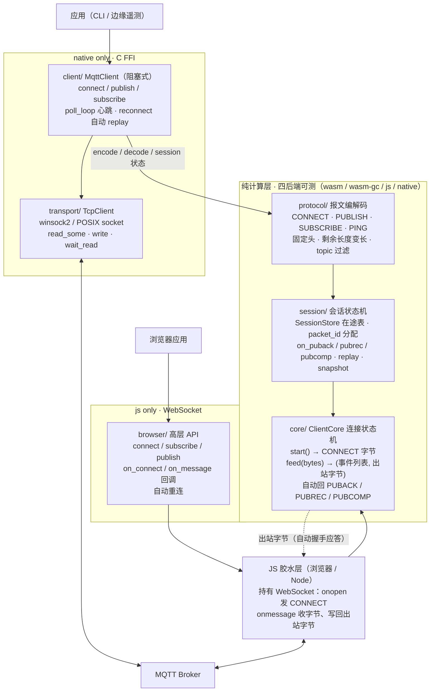
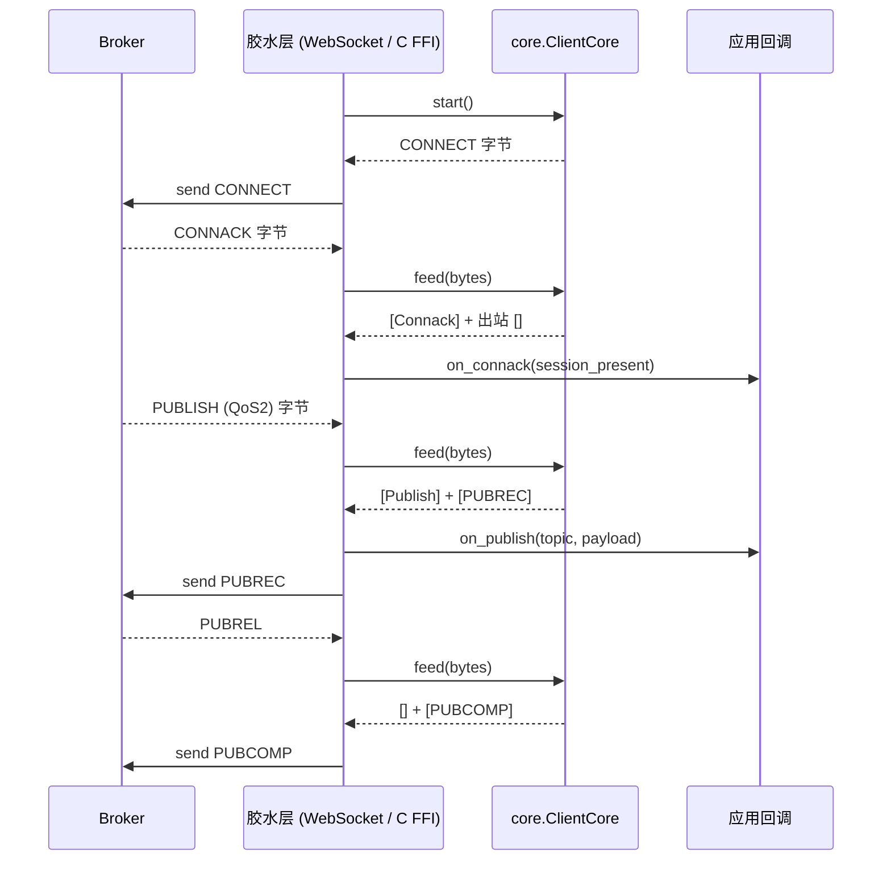

# moon-mqtt

MoonBit 生态的 MQTT 3.1.1 客户端库。阻塞式 native client + 纯计算 core/ 连接状态机（四后端可测）+ 浏览器 WebSocket 胶水层。MQTT 5.0 为后续路线。

## 竞品对照

MoonBit 生态已有两个相关项目：

| 项目 | 做了什么 | 缺什么 |
|---|---|---|
| `zbhzs1/moonbit-mqtt` | packet codec | 无 transport、无 client runtime |
| `Strangelight-Merser/moon-mqtt-client` | async client（QoS0/1） | 无 QoS2 exactly-once |
| **moon-mqtt** | QoS0/1/2 全量、持久会话恢复、core/ 纯计算连接状态机（四后端可测）、浏览器 WebSocket 胶水层 | 阻塞式，无异步封装 |

参考移植（原创重写，不复制源码）：API 设计参考 [MQTT.js](https://github.com/mqttjs/MQTT.js)（MIT），协议行为参考 [Eclipse Paho C](https://github.com/eclipse/paho.mqtt.c)（EPL-2.0/EDL-1.0）。本项目许可证 **MIT**。

## 安装

需要 [MoonBit 工具链](https://www.moonbitlang.com/)（moon ≥ 0.1.20261012）。

```bash
moon add Duckweed/moon-mqtt@0.2.0
```

也可以直接在 `moon.mod` 里加依赖：

```toml
import {
  "Duckweed/moon-mqtt",
}
```

## 快速上手

仓库自带三个可运行示例：

```bash
moon run examples/pubsub    # PUBLISH 编解码往返，不连 broker
moon run examples/resume    # QoS2 中断重连 / 会话恢复时间线（纯计算）
# 第三个 examples/ws-spike 是浏览器 WebSocket 端到端，见下方「浏览器 WebSocket 连接」章节
```

### pubsub：报文编解码

```moonbit
let qos = match @protocol.qos_from_int(1) { Some(q) => q None => return }
let pkt = @protocol.PublishPacket::new(
  "sensors/temp", [0x32, 0x33], qos, false, false, 7,
)
let bytes = @protocol.encode_publish(pkt)
match @protocol.decode_publish(bytes) { ... }
```

输出：`encoded (20 bytes)` / `decoded: topic=sensors/temp payload=[50, 51] qos=1`

### resume：QoS2 中断重连

不连真实 broker，纯计算走一遍：发 QoS2 PUBLISH → PUBREC → 断线 → 重连 replay → PUBREL → PUBCOMP → 清空。这是 MQTT 3.1.1 持久会话语义的核心演示。

### ws-spike：浏览器 WebSocket（见下节）

## 浏览器 WebSocket 连接

`examples/ws-spike/` 用 MoonBit js 后端编译成 JS bundle，在 Node 里连公共 EMQX broker `wss://broker.emqx.io:8084/mqtt`（子协议 `mqtt`），端到端打通 CONNECT → CONNACK → SUBSCRIBE → SUBACK → 收 PUBLISH。

```powershell
moon build --target js examples/ws-spike
node "_build\js\debug\build\examples\ws-spike\ws-spike.js"
```

Node 实测输出：

```
[spike] core start() generated CONNECT, 22 bytes
[spike] connecting to wss://broker.emqx.io:8084/mqtt (subprotocol mqtt)
[spike] onopen, sending CONNECT, 22 bytes
[spike] onmessage hex: 20 02 00 00
[spike] core feed() events: [Connack(session_present=0, return_code=Accepted)]
[spike] sending SUBSCRIBE pid=1 sensors/# QoS1
[spike] onmessage hex: 90 03 00 01 01
[spike] core feed() events: [Suback(subscribed to sensors/#)]
[spike] onmessage hex: 30 13 00 0C 73 65 6E 73 6F 72 73 2F 74 65 73 74 68 65 6C 6C 6F
[spike] core feed() events: [Publish(topic=sensors/test, payload=68 65 6C 6C 6F)]
```

`68 65 6C 6C 6F` = ASCII "hello"。另一个 node 发布脚本经同一 WebSocket 发入 broker，ws-spike 端真实收到并由 `core.feed()` 解析成 `PublishReceived` 事件。

**B 方案架构**：JS 胶水层持有 `WebSocket`（建连、onopen 发 CONNECT、onmessage 收字节），MoonBit core 只导出纯函数：

- `ClientCore::new(opts).start() -> Array[Int]`：生成 CONNECT 帧字节
- `core.feed(bytes) -> (Array[CoreEvent], Array[Int] 出站字节)`：喂入 broker 字节，返回事件 + 需要回发的字节（PUBACK/PUBREC/PUBCOMP 等）

core 不 import 任何 WebSocket/socket 依赖，同一份代码在 native（C FFI TCP）和 js/wasm（WebSocket）下零改动复用。设计细节见 [docs/WS-SPIKE.md](docs/WS-SPIKE.md)。

> ws-spike 是 spike 验证，不是正式浏览器 API。正式浏览器 client 封装见下文 `browser/` 包。

## 浏览器快速上手

`browser/` 包提供高层 API，浏览器项目 `moon add Duckweed/moon-mqtt@0.2.0` 后直接 import：

```moonbit
// your-app/main.mbt
import {
  "Duckweed/moon-mqtt/browser" @browser,
  "Duckweed/moon-mqtt/protocol" @protocol,
}

fn main() -> Unit {
  let client = @browser.connect("broker.emqx.io", 8084, "my-browser-client")

  // 收到 PUBLISH 消息
  @browser.on_message(client, fn(topic, payload) {
    println("recv " + topic)
  })

  // 连接成功后再订阅 / 发布
  @browser.on_connect(client, fn() {
    @browser.subscribe(client, "sensors/#", @protocol.qos1())
    @browser.publish(client, "sensors/hello", [0x68, 0x69], @protocol.qos0())
  })

  // 用完断开
  // @browser.disconnect(client)
}
```

API 一览：

| 函数 | 说明 |
|---|---|
| `connect(host, port, client_id) -> Client` | 建立 WSS 连接，自动发 CONNECT |
| `on_connect(client, handler)` | 收到 CONNACK 后回调 |
| `on_message(client, handler)` | 收到 PUBLISH 时回调 `(topic, payload)` |
| `subscribe(client, topic, qos)` | 订阅主题 |
| `publish(client, topic, payload, qos)` | 发布消息（QoS0 完整支持） |
| `disconnect(client)` | 发 DISCONNECT 并关闭 |

内部实现：`browser/` 持有 `@core.ClientCore` 纯计算状态机，WebSocket 由 JS 胶水层持有，`on_message` / `on_close` 回调经 mangled 名从 JS 调回 MoonBit。断线自动重连（1s 间隔，最多 3 次）。

完整示例见 [examples/browser-demo/](examples/browser-demo/)。

## Native TCP 连接

`client/` 提供阻塞式 `MqttClient`，适合 CLI / 边缘遥测上报等确定性场景。

```moonbit
// 自定义 CONNECT（带认证 + 遗嘱 + 持久会话）
let opts = @protocol.ConnectPacket::new("demo-client")
  .with_keep_alive(30)
  .with_clean_session(false)
  .with_auth("user", [0x70, 0x61, 0x73, 0x73])   // "pass"
  .with_will("status", "offline".to_bytes(), @protocol.qos1(), false)

let client = @client.connect_opts("broker.hivemq.com", 1883, opts)?

// 订阅并注册回调
client.subscribe_with_handler("sensors/#", @protocol.qos1(), fn(topic, payload) {
  println("recv " + topic)
})?

// 主循环：每 1 秒 poll 一次，到 keep_alive 自动发 PINGREQ
// 失败返回 Err 时调 reconnect() 自动重连 + 会话恢复
match client.poll_loop(600, 1000) {
  Ok(_) => ()
  Err(_) => {
    let client = client.reconnect()?
    println("reconnected, session_present=" + client.is_session_present().to_string())
  }
}
client.disconnect()?
```

`?` 为 Result 传播。`qos1()` / `qos0()` / `qos2()` 是跨包构造 QoS 枚举的 helper。

## 真实用例：物联网边缘遥测上报

```moonbit
// 1. 连到 broker
let client = @client.connect("192.168.1.10", 1883, "sensor-node-07")?

// 2. 周期上报传感器读数（QoS1）
client.publish("sensors/temp", [0x32, 0x33], @protocol.QoS.AtLeastOnce)?

// 3. 订阅控制指令（QoS0）
client.subscribe("control/sensor-07/#", @protocol.QoS.AtMostOnce)?

// 4. 保活 + 正常下线
client.ping()?
client.disconnect()?
```

协议编解码与 QoS 状态机是纯计算（四后端可测），网络层在 native 上自写 C FFI socket。

## 设计

五层架构（框内标注纯计算层四后端可测 vs native only）：



两条运行路径共用同一份纯计算包：

- **native 路径**：`client/` 直接用 `protocol/` + `session/` + `transport/` 组装阻塞式 `MqttClient`，走 C FFI TCP。
- **浏览器 / Node 路径**：`browser/` 高层 API 持有 `@core.ClientCore`，JS 胶水层持有 WebSocket，经 mangled 名回调 MoonBit 的 `browser_on_message` / `browser_on_close`；`core/` 收到字节后吐事件给应用，同时吐出站字节由 `browser_send` 写回 broker。
- `protocol/`、`session/`、`core/` 不 import 任何 platform 依赖，覆盖 wasm / wasm-gc / js / native 四个后端；`transport/` 与 `client/` 仅 native，`browser/` 仅 js。
- QoS2 exactly-once（PUBREC/PUBREL/PUBCOMP 握手）与断线重连状态边界是核心差异化。

`core/` 入站字节的数据流（`feed()` 一次调用同时产出事件与出站字节）：



详细设计见 [docs/ARCHITECTURE.md](docs/ARCHITECTURE.md)。

### CONNECT 字段支持

| MQTT 3.1.1 CONNECT 字段 | 支持 |
|---|---|
| Client Identifier | ✅ 必填 |
| Keep Alive | ✅ 默认 60s，可配 |
| Clean Session | ✅ 默认 true，可配 |
| Username / Password | ✅ 可选 |
| Will Message（topic / payload / QoS / retain） | ✅ 可选 |
| 持久会话恢复 | ✅ 在途 QoS1/2 PUBLISH 由 `SessionStore` 记录，断线重连后 `replay()` 按 §4.4 重发 |

## 状态

- [x] `protocol/` MQTT 3.1.1 报文编解码
- [x] `session/` 会话状态机（QoS2 exactly-once、报文标识分配、在途持久会话）
- [x] `core/` ClientCore 连接状态机（start/feed、入站 QoS1/2 自动握手、出站 QoS1/2 publish 自动在途追踪、断线重连、replay 重发、SessionStore 接入）
- [x] `transport/` native TCP 网络层（C FFI，跨平台，带 wait_read 超时）
- [x] `client/` 高层 API（connect / publish / subscribe / poll_loop 自动心跳 / reconnect 自动重连 / disconnect）
- [x] `browser/` 浏览器高层 API（connect / subscribe / publish / on_connect / on_message / 自动重连，js 后端）
- [x] 浏览器 WebSocket 端到端打通（`examples/ws-spike/`）
- [x] mooncakes 发布（`Duckweed/moon-mqtt@0.2.0`）
- [x] `moon test --target wasm-gc` 74/74 通过；`moon test --target native` 77/77 通过；0 警告

## 构建与测试

```bash
moon check
moon test --target wasm-gc    # 纯计算层
moon test --target wasm
moon test --target js
moon test --target native
moon run examples/pubsub
moon run examples/resume
moon build --target js examples/ws-spike   # 浏览器 WebSocket 示例
```

CI（GitHub Actions，Linux / Windows 双矩阵）覆盖 check + build + 四后端 test + 示例运行。

## 手动验证（连真 broker）

```bash
# 1. 起本地 broker
mosquitto -p 1883 -v

# 2. 另开终端订阅
mosquitto_sub -h 127.0.0.1 -t 'sensors/#' -v

# 3. 跑 MoonBit 程序（connect → publish → subscribe → ping → disconnect）
#    代码见上方 "Native TCP 连接" 章节
```

## AI 工具使用说明

本项目开发使用了 AI 编程工具辅助，目标、技术路径、质量边界和开源合规由参赛者本人把控：

- AI 辅助了协议报文编解码的样板代码、单测用例生成、README 初稿润色。
- 人把控了项目选题、五层架构、QoS 状态机边界条件、C FFI 边界设计、已知限制的如实声明、与 mooncakes 现有项目的查重。
- AI 生成的单测都由人对照 OASIS MQTT 3.1.1 规范核对过断言；协议编解码有往返测试（encode → decode → 字段比对）；CI 四后端测试全绿才合并。
- 不照搬其他开源项目代码（API 参考 MQTT.js / Paho C，实现是 MoonBit 重写）；不把 AI 生成的测试数据当真理。

## 已知限制

- **会话快照落盘**：`SessionStore` 提供 `snapshot()` / `restore()` 字节级原语，调用方自行写盘；库本身不做文件读写。
- **`transport/` 与 `client/` 仅 native**：依赖 C FFI socket。`protocol/`、`session/`、`core/` 四后端可测。浏览器场景通过 `browser/` 包 + WebSocket 胶水层接入，已端到端验证。`browser/` 仅 js 后端。
- **阻塞式 API**：`client/` 为阻塞式，适合 CLI / 边缘遥测；高并发长连接场景需要异步封装，当前未提供。
- **同步握手期间的入站 PUBLISH**：`publish` 等 PUBACK/PUBREC/PUBCOMP、`subscribe` 等 SUBACK 时，若 broker 恰好推来订阅主题的 PUBLISH，当前代码返回 `"expected XXX"` 错误并丢弃该帧。边发布边接收应改用 `poll_loop` + `subscribe_with_handler`。
- **坏协议帧卡缓冲**：`core/Framer` 遇到无法识别的帧（剩余长度 >4 字节、保留报文类型等）会把这帧永久留在内部缓冲里，不再产出后续帧，也不 reset 缓冲。正常 broker 不会发这种帧；若需要对端异常时主动断开，需在调用方加超时检测。
- **`client/` 层无独立单测**：client 是 native + C FFI，无法在 wasm 后端实例化；其正确性由 protocol/session/core 纯层测试（wasm-gc 77 / native 80）+ 三个示例手动/端到端验证共同保障。
- **MQTT 5.0 本期不做**：预计 2027 Q1 评估基础字段。TLS 预计 2027 Q2。

## 许可证

MIT © Duckweed-yhb
