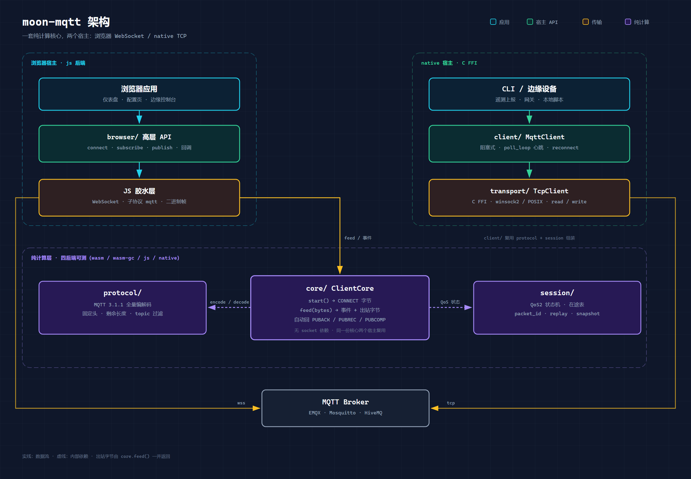

# 架构

moon-mqtt 由六个包组成：三个纯计算包、一个 js 宿主包、两个 native 包。



- **纯计算**：`protocol/` `session/` `core/`，四后端可测
- **浏览器宿主**：`browser/`，js 后端，持有 `core/ClientCore`，WebSocket 由 JS 胶水层持有
- **native 宿主**：`client/` + `transport/`，C FFI TCP

两条运行路径共用 `protocol/` 与 `session/`：

- **浏览器**：`browser/` 持有 `core/`；JS 胶水层持有 WebSocket，`onopen` 发 CONNECT，`onmessage` 把字节喂给 `core.feed()`，出站字节写回 broker。
- **native**：`client/` 组合 `protocol/` + `session/` + `transport/`，走 C FFI TCP，不经过 `core/`。

## 分层职责

### `protocol/`（纯计算，四后端）

只做报文字节数组 ↔ 结构体的转换。不持有状态，不做 I/O。

- `connect.mbt`：CONNECT 编码 / CONNACK 解码
- `publish.mbt`：PUBLISH 编解码
- `subscribe.mbt`：SUBSCRIBE/SUBACK/UNSUBSCRIBE/UNSUBACK 编解码
- `ping.mbt`：PINGREQ/PINGRESP/DISCONNECT 编解码
- `fixed_header.mbt`：固定头 + 剩余长度变长编码
- `topic.mbt`：topic filter 匹配（`+` / `#`）
- `decode.mbt`：统一入站分发 `decode_packet`
- `bytes_util.mbt`：字节读写辅助

### `session/`（纯计算，四后端）

持有会话状态，但不做 I/O。所有函数都是 `(store, input) -> (new_store, output)` 形式，方便单测。

- `SessionStore`：在途 QoS1/2 PUBLISH 表
  - `record_outbound(pkt)`：分配 packet_id，记录到 inflight
  - `on_puback/pubrec/pubcomp`：推进状态机
  - `replay()`：断线重连时产出待重发字节序列
  - `snapshot()/restore()`：字节级落盘快照
- packet_id 分配器：1..65535 循环，跳过 inflight 已占用 id

### `core/`（纯计算，四后端）

连接状态机，是 B 方案的核心：胶水层（JS WebSocket 或 C FFI）持有 socket，`core/` 只导出纯函数。

- `ClientCore::new(opts)` / `with_session(opts, store)`：初始状态 = Connecting
- `start() -> Array[Int]`：socket 打开后调用，返回 CONNECT 帧字节
- `feed(bytes) -> (Array[CoreEvent], Array[Int])`：喂入 broker 字节，返回事件列表 + 需要回发的出站字节
  - 收到 CONNACK → 状态切 Connected，抛 `ConnackReceived`
  - 收到 PUBLISH → 抛 `PublishReceived`；QoS1 自动追加 PUBACK，QoS2 自动追加 PUBREC
  - 收到 PUBREL → 自动追加 PUBCOMP
  - 收到 PUBACK/PUBREC/PUBCOMP → 推进内部 `SessionStore`（出站在途 QoS 握手）
- `on_transport_close()` / `reconnect_bytes()`：断线时状态切 Disconnected、SessionStore 保留；重连时重置状态、清 framer 残留缓冲、重新编码 CONNECT
- `Framer`：把 socket 推过来的字节流拆成完整 MQTT 帧，处理半包 / 粘包

`core/` 不 import 任何 WebSocket / socket 依赖，同一份代码在四个后端下零改动编译。native 上 `core/` 供测试使用，`client/` 不走它；浏览器路径由 `core/` 驱动。

### `browser/`（js only）

浏览器宿主的高层封装。内部持有 `core/ClientCore`，WebSocket 对象由 JS 胶水层持有，MoonBit 侧只做纯计算。

- `connect(host, port, client_id)`：WSS + `clean_session=true`
- `connect_opts(host, port, opts)`：自定义 CONNECT，可带认证 / 遗嘱 / clean_session
- `connect_persistent(host, port, client_id)`：`clean_session=false`，重连后拿回同一个会话
- `on_connect` / `on_suback` / `on_message`：CONNACK、SUBACK、PUBLISH 回调
- `subscribe` / `publish` / `disconnect`
- `publish` 支持 QoS0/1/2：QoS1/2 走 `core.publish()`，packet_id 与在途由 `core/` + `session/` 管理
- 断线后 1 秒自动重连，最多 3 次；`session_present=1` 时把在途帧 replay 出去
- 限制：单连接全局状态，一个页面实例只支持一个 client

### `transport/`（native only）

C FFI 原生 socket。Windows 用 winsock2，Linux/macOS 用 POSIX socket。

- `connect(host, port)`：阻塞连接
- `read_some(max)` / `write(bytes)`：读写原始字节
- `wait_read(timeout_ms)`：select 等待可读，用于 poll_once 超时
- `close()`：关闭 socket

字节经 MoonBit `String` 的 UTF-16 单元承载（每个单元存一个 0-255 字节值），避免 C 侧构造/返回数组。

### `client/`（native only）

把 `protocol/` + `session/` + `transport/` 组装成 `MqttClient`。阻塞式单线程。注意：native 路径不经过 `core/`，读帧与握手由 `client/` 自身完成。

- `connect_opts(host, port, ConnectPacket)`：握手 CONNECT/CONNACK
- `publish(topic, payload, qos)`：QoS0 直发 / QoS1 等 PUBACK / QoS2 三段握手
- `subscribe_with_handler(filter, qos, handler)`：注册回调
- `poll_once(timeout_ms)`：读一帧并派发
- `poll_loop(rounds, timeout_ms)`：连调 poll_once，自动心跳
- `reconnect()`：重连 + 带旧 store + 自动 replay
- `disconnect()`：发 DISCONNECT 并关 socket

## 数据流

### native 入站 PUBLISH 派发

```
broker ──bytes──► transport.read_some
                      │
                      ▼
              client.read_frame（拼帧：固定头 + 剩余长度变长）
                      │
                      ▼
              protocol.decode_packet
                      │
            ┌─────────┼─────────┐
            ▼         ▼         ▼
         PUBLISH   PUBACK/...  PINGRESP/SUBACK/...
            │         │         │
            ▼         ▼         ▼
       回 PUBACK/  推进 store   静默消化
       PUBREC+
            │
            ▼
       按 topic filter 匹配 subs 表，调 handler(topic, payload)
```

### 浏览器 / Node 入站（core.feed 循环）

```
broker ──WebSocket──► JS onmessage
                          │
                          ▼
                  core.feed(bytes)
                   │            │
                   ▼            ▼
              events[]     outgoing[]
              (给应用)    (胶水层写回 socket)
```

## 测试矩阵

| 包 / 示例 | wasm | wasm-gc | js | native |
|---|---|---|---|---|
| `protocol/` | ✅ | ✅ | ✅ | ✅ |
| `session/` | ✅ | ✅ | ✅ | ✅ |
| `core/` | ✅ | ✅ | ✅ | ✅ |
| `browser/` | - | - | ✅ | - |
| `transport/` | - | - | - | ✅ |
| `client/` | - | - | - | ✅（`client_wbtest.mbt` 25 条，经 `Conn` 假连接覆盖主路径） |
| `examples/pubsub` | - | ✅ | - | ✅ |
| `examples/resume` | - | ✅ | - | ✅ |
| `examples/browser-demo` | - | - | ✅ | - |
| `examples/ws-spike` | - | - | ✅ | - |

`moon test --target wasm-gc` 82/82，`moon test --target native` 107/107；`moon check --target js --deny-warn` 0 警告。纯计算层四后端可测，`browser/` 与两个浏览器示例只编 js，`transport/` 与 `client/` 只编 native。
